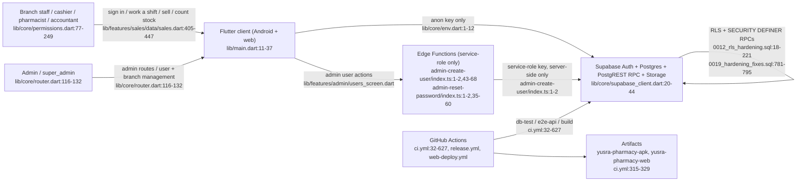
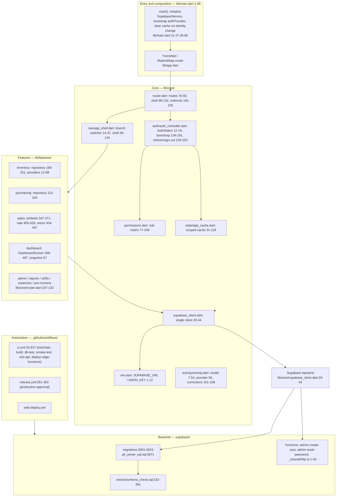
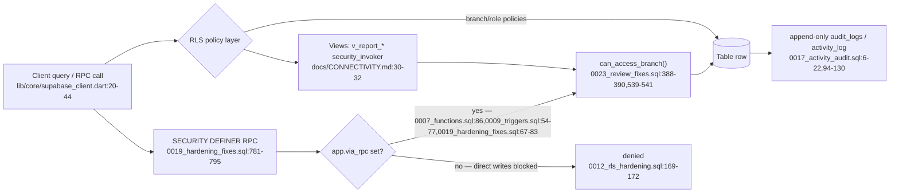
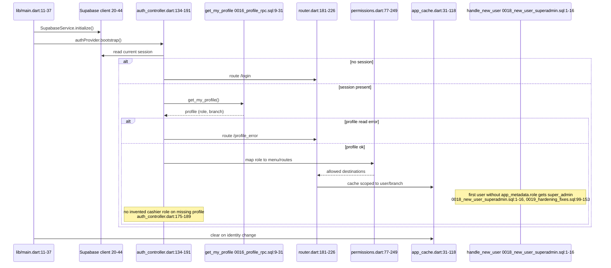
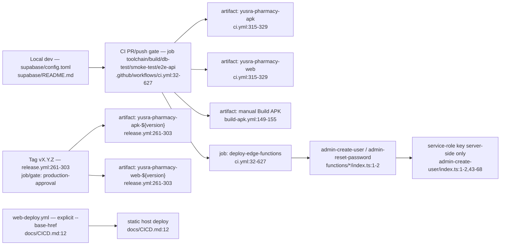
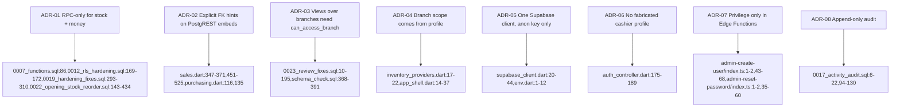
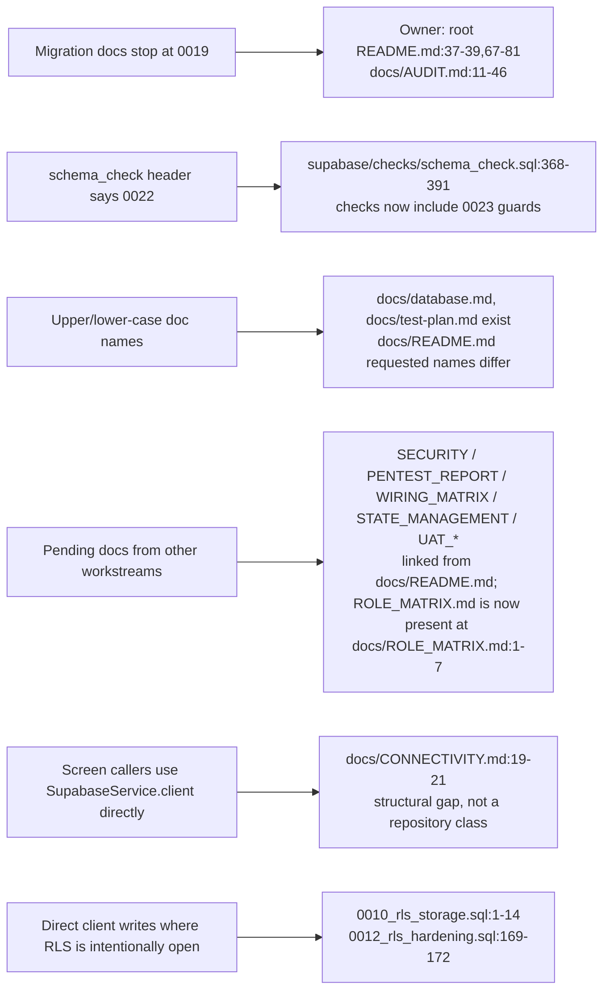

# Architecture — Yusra Pharmacy

> **Scope.** Workstream 1 documentation, derived only from code, SQL, CI and
> checked-in artifacts. Every factual statement below is followed by a
> `file:line` reference, a CI job name, or an artifact name. No claim is made
> from memory or from an unverified assumption.
>
> **Source of truth.** The Flutter client in `lib/`, the SQL migrations in
> `supabase/migrations/0001_*.sql` … `0026_*.sql` (`all_owner_sql.sql:3671`
> marks the last bundled mirror, through `0023_*.sql`), the verification contract in
> `supabase/checks/schema_check.sql:232-391`, and the workflows in
> `.github/workflows/` (entry points: `ci.yml:3-10`, `release.yml`,
> `web-deploy.yml`, `deploy-functions.yml`). Companion indexes: `docs/README.md`, `docs/CONNECTIVITY.md`,
> `docs/SCREEN_MATRIX.md`, `docs/database.md`, `docs/test-plan.md`,
> `docs/CICD.md`.

---

## 0. Evidence map

| Layer | Where the truth lives | Evidence |
| --- | --- | --- |
| Bootstrap / DI / routing / shell / permissions / cache / activity | Flutter core | `lib/main.dart:1-85`, `lib/core/router.dart:76-226`, `lib/core/nav/app_shell.dart:14-37,39-134`, `lib/core/permissions.dart:77-249`, `lib/core/state/app_cache.dart:31-118`, `lib/core/activity/activity.dart:7-108` |
| Single Supabase client / environment | Flutter core | `lib/core/supabase_client.dart:20-44`, `lib/core/env.dart:1-12` |
| Auth & profile bootstrap | Auth controller + RPCs | `lib/core/auth/auth_controller.dart:12-19,134-191,245-253`, `supabase/migrations/0016_profile_rpc.sql:9-31`, `supabase/migrations/0018_new_user_superadmin.sql:1-16`, `supabase/migrations/0019_hardening_fixes.sql:99-153` |
| Business features | Per-feature data + screens | `lib/features/inventory/data/inventory_repository.dart:169-251`, `lib/features/inventory/data/inventory_providers.dart:12-88`, `lib/features/purchasing/data/purchasing.dart:113-244`, `lib/features/sales/data/sales.dart:347-525`, `lib/features/dashboard/dashboard_screen.dart:399-497` |
| Database schema / enums / RLS / RPCs | SQL migrations | `supabase/migrations/0001_extensions_enums.sql:4-10`, `0002_*.sql:1-113`, `0003_*.sql:1-52`, `0004_*.sql:1-31`, `0005_*.sql:1-35`, `0006_*.sql:1-139`, `0007_functions.sql:1-319`, `0010_rls_storage.sql:1-14`, `0012_rls_hardening.sql:18-221`, `0014_report_views.sql`, `0016_profile_rpc.sql:9-31`, `0017_activity_audit.sql:6-22,94-130`, `0019_hardening_fixes.sql:17-557,781-831`, `0020_fix_sale_return.sql:14-98`, `0021_grants.sql:17-37`, `0022_opening_stock_reorder.sql:13-434`, `0023_review_fixes.sql:10-135,348-563` |
| Verification | Schema check + CI | `supabase/checks/schema_check.sql:232-391`, CI jobs `toolchain`, `build`, `db-test`, `smoke-test`, `e2e-api`, `deploy-edge-functions` (`.github/workflows/ci.yml:32-627`) |
| Server-side privileged code | Edge Functions | `supabase/functions/admin-create-user/index.ts:1-2,43-68`, `supabase/functions/admin-reset-password/index.ts:1-2,35-60`, `supabase/functions/_shared/http.ts:1-43` |
| Shared row actions | Core widget + invalidation graph | `lib/core/widgets/row_actions.dart:1-120`, `lib/core/widgets.dart:1-9`, `lib/core/state/invalidation.dart:17-33,120-160` |
| Staff creation / deployment | Edge Function + manual workflow | `supabase/functions/admin-create-user/index.ts:19-80,255-285`, `.github/workflows/deploy-functions.yml:1-40`, `lib/features/admin/users_screen.dart:198-250` |
| Row-action audit coverage | Additive migration | `supabase/migrations/0026_row_actions_audit.sql:1-20`, `supabase/migrations/0009_triggers.sql:101-129` |

---

## (a) System context

| Boundary | What crosses it | Evidence |
| --- | --- | --- |
| User → client | Role-filtered routes and menu; `/login`, `/forgot-password`, `/reset-password`, `/forbidden`, `/profile_error` are outside the shell | `lib/core/router.dart:76-93`, `lib/core/router.dart:96-132`, `lib/core/permissions.dart:77-249` |
| Client → Supabase | One shared client configured from `SUPABASE_URL` / `SUPABASE_ANON_KEY`; no service-role key in the app | `lib/core/supabase_client.dart:20-44`, `lib/core/env.dart:1-12`, `docs/CICD.md:15-18` |
| Client → Edge Functions | Admin user create/reset password only | `supabase/functions/admin-create-user/index.ts:1-2,43-68`, `supabase/functions/admin-reset-password/index.ts:1-2,35-60` |
| Backend internal | RLS on tables, `SECURITY DEFINER` RPCs with `app.via_rpc` guards, `has_role` / `can_access_branch` checks | `0010_rls_storage.sql:1-14`, `0012_rls_hardening.sql:18-221`, `0019_hardening_fixes.sql:67-83,781-795`, `0022_opening_stock_reorder.sql:383-416` |
| CI → release | CI artifacts `yusra-pharmacy-apk` / `yusra-pharmacy-web`; release artifacts `yusra-pharmacy-apk-${version}` / `yusra-pharmacy-web-${version}` plus `production-approval` | `.github/workflows/ci.yml:315-329`, `.github/workflows/release.yml:261-303` |

---

## (b) Layered app architecture / folder map

| Folder | Responsibility (with evidence) |
| --- | --- |
| `lib/main.dart` | Entry point: `SupabaseService.initialize()`, `authProvider.bootstrap()`, cache clear on identity change (`lib/main.dart:11-37,39-85`). |
| `lib/core/` | Shared client, env, router, auth, permissions, cache, shell, activity (`lib/core/supabase_client.dart:20-44`, `lib/core/router.dart:76-226`, `lib/core/permissions.dart:77-249`, `lib/core/state/app_cache.dart:31-118`, `lib/core/nav/app_shell.dart:14-134`, `lib/core/activity/activity.dart:7-108`). |
| `lib/features/inventory/` | Opening stock, reorder, stock batches/movements, low-stock and expiry alerts (`lib/features/inventory/data/inventory_repository.dart:185-251`, `lib/features/inventory/data/inventory_providers.dart:39-88`). |
| `lib/features/purchasing/` | Draft POs, lines, status transitions, receiving (`lib/features/purchasing/data/purchasing.dart:146-244`). |
| `lib/features/sales/` | POS cart → sale, returns, explicit PostgREST FK embeds (`lib/features/sales/data/sales.dart:347-371,405-447,451-525`). |
| `lib/features/dashboard/` | Dashboard snapshot/tiles and quiet refresh (`lib/features/dashboard/dashboard_screen.dart:57,399-497`). |
| `supabase/migrations/` | Schema, policies, RPCs, grants; final bundled migration is `0023_review_fixes.sql` (`supabase/all_owner_sql.sql:3671`). |
| `supabase/checks/` | Contract checked in CI `db-test` (CI job `db-test`, `supabase/checks/schema_check.sql:232-391`). |
| `supabase/functions/` | Privileged user admin operations with service-role key server-side only (`supabase/functions/admin-create-user/index.ts:1-2,43-68`). |
| `.github/workflows/` | PR gate, release, web deploy (`ci.yml:3-10,32-627`, `release.yml:261-303`, `web-deploy.yml`). |

---

## (c) Database ERD — tables, FKs, enums, RLS, RPCs, `SECURITY DEFINER`, `app.via_rpc`

```mermaid
erDiagram
  branches ||--o{ profiles : "branch_id — 0002_core_tables_helpers.sql:1-113"
  branches ||--o{ purchase_orders : "branch_id — 0004_purchasing.sql:1-31"
  branches ||--o{ stock_batches : "branch_id — 0005_stock.sql:1-35"
  branches ||--o{ sales : "branch_id — 0006_sales_finance.sql:1-139"
  branches ||--o{ expenses : "branch_id — 0006_sales_finance.sql:1-139,0019_hardening_fixes.sql:444-446"
  profiles ||--o{ activity_log : "actor_id — 0017_activity_audit.sql:6-22"
  helpers ||--o{ sales : "helper links — 0002_core_tables_helpers.sql:1-113,0006_sales_finance.sql:1-139"
  categories ||--o{ medicines : "category_id — 0003_catalog.sql:1-52"
  suppliers ||--o{ medicines : "supplier_id — 0003_catalog.sql:1-52"
  suppliers ||--o{ purchase_orders : "supplier_id — 0004_purchasing.sql:1-31"
  purchase_orders ||--|{ purchase_order_items : "po_id — 0004_purchasing.sql:1-31"
  medicines ||--o{ purchase_order_items : "medicine_id — 0004_purchasing.sql:1-31"
  medicines ||--o{ stock_batches : "medicine_id — 0005_stock.sql:1-35"
  stock_batches ||--o{ stock_movements : "batch_id — 0005_stock.sql:1-35"
  medicines ||--o{ stock_movements : "medicine_id — 0005_stock.sql:1-35"
  sales ||--|{ sale_items : "sale_id — 0006_sales_finance.sql:1-139"
  medicines ||--o{ sale_items : "medicine_id — 0006_sales_finance.sql:1-139"
  stock_batches ||--o{ sale_items : "batch_id — 0006_sales_finance.sql:1-139"
  sales ||--|{ sale_payments : "sale_id — 0006_sales_finance.sql:1-139"
  sales ||--o{ sale_returns : "sale_id — 0006_sales_finance.sql:1-139,0020_fix_sale_return.sql:14-98"
  customers ||--o{ sales : "customer_id — 0006_sales_finance.sql:1-139"
  shifts ||--o{ sales : "shift_id — 0006_sales_finance.sql:1-139"
  prescriptions ||--o{ prescription_items : "prescription_id — 0006_sales_finance.sql:1-139"
  sales ||--o{ audit_logs : "row audit — 0017_activity_audit.sql:6-22"

  branches {
    uuid id PK "0002_core_tables_helpers.sql:1-113"
    text name "0002_core_tables_helpers.sql:1-113"
  }
  profiles {
    uuid id PK "auth.users id — 0002_core_tables_helpers.sql:1-113"
    uuid branch_id FK "0002_core_tables_helpers.sql:1-113"
    app_role role "0001_extensions_enums.sql:4-10,0002_core_tables_helpers.sql:1-113"
  }
  helpers {
    uuid id PK "0002_core_tables_helpers.sql:1-113"
    uuid branch_id FK "0002_core_tables_helpers.sql:1-113"
  }
  categories {
    uuid id PK "0003_catalog.sql:1-52"
  }
  suppliers {
    uuid id PK "0003_catalog.sql:1-52"
    boolean is_active "0003_catalog.sql:1-52"
  }
  medicines {
    uuid id PK "0003_catalog.sql:1-52"
    uuid category_id FK "0003_catalog.sql:1-52"
    uuid supplier_id FK "0003_catalog.sql:1-52"
    int reorder_point "0022_opening_stock_reorder.sql:13-24"
    int reorder_qty "0022_opening_stock_reorder.sql:13-24"
  }
  purchase_orders {
    uuid id PK "0004_purchasing.sql:1-31"
    uuid branch_id FK "0004_purchasing.sql:1-31"
    uuid supplier_id FK "0004_purchasing.sql:1-31"
    po_status status "0001_extensions_enums.sql:4-10,0004_purchasing.sql:1-31"
  }
  purchase_order_items {
    uuid id PK "0004_purchasing.sql:1-31"
    uuid po_id FK "0004_purchasing.sql:1-31"
    uuid medicine_id FK "0004_purchasing.sql:1-31"
  }
  stock_batches {
    uuid id PK "0005_stock.sql:1-35"
    uuid branch_id FK "0005_stock.sql:1-35"
    uuid medicine_id FK "0005_stock.sql:1-35"
    date expiry_date "0005_stock.sql:1-35"
  }
  stock_movements {
    uuid id PK "0005_stock.sql:1-35"
    uuid batch_id FK "0005_stock.sql:1-35"
    movement_type movement_type "0001_extensions_enums.sql:4-10,0005_stock.sql:1-35"
  }
  sales {
    uuid id PK "0006_sales_finance.sql:1-139"
    uuid branch_id FK "0006_sales_finance.sql:1-139"
    sale_status status "0001_extensions_enums.sql:4-10,0006_sales_finance.sql:1-139"
    payment_method payment_method "0001_extensions_enums.sql:4-10,0006_sales_finance.sql:1-139"
  }
  sale_items {
    uuid id PK "0006_sales_finance.sql:1-139"
    uuid sale_id FK "0006_sales_finance.sql:1-139"
    uuid medicine_id FK "0006_sales_finance.sql:1-139"
    uuid batch_id FK "0006_sales_finance.sql:1-139"
  }
  sale_payments {
    uuid id PK "0006_sales_finance.sql:1-139"
    uuid sale_id FK "0006_sales_finance.sql:1-139"
    payment_method method "0001_extensions_enums.sql:4-10,0006_sales_finance.sql:1-139"
  }
  sale_returns {
    uuid id PK "0006_sales_finance.sql:1-139,0020_fix_sale_return.sql:14-98"
    uuid sale_id FK "0006_sales_finance.sql:1-139"
  }
  shifts {
    uuid id PK "0006_sales_finance.sql:1-139"
    shift_status status "0001_extensions_enums.sql:4-10,0006_sales_finance.sql:1-139"
  }
  prescriptions {
    uuid id PK "0006_sales_finance.sql:1-139"
    rx_status status "0001_extensions_enums.sql:4-10,0006_sales_finance.sql:1-139"
  }
  prescription_items {
    uuid id PK "0006_sales_finance.sql:1-139"
    uuid prescription_id FK "0006_sales_finance.sql:1-139"
  }
  customers {
    uuid id PK "0006_sales_finance.sql:1-139"
  }
  expenses {
    uuid id PK "0006_sales_finance.sql:1-139"
    text status "0019_hardening_fixes.sql:444-446"
  }
  audit_logs {
    uuid id PK "0017_activity_audit.sql:6-22"
  }
  activity_log {
    uuid id PK "0017_activity_audit.sql:6-22"
    uuid actor_id FK "0017_activity_audit.sql:6-22"
  }
```

### Enums (declared once, reused across tables)

| Enum | Values / evidence |
| --- | --- |
| `app_role` | Super admin, admin, pharmacist, cashier, store keeper, accountant roles are defined in `supabase/migrations/0001_extensions_enums.sql:4-10` and used by `profiles.role` (`0002_core_tables_helpers.sql:1-113`), `has_role` (`0007_functions.sql`), `lib/core/permissions.dart:77-249`. |
| `po_status` | Purchase-order lifecycle values in `0001_extensions_enums.sql:4-10`; column typed at `0004_purchasing.sql:1-31`. |
| `sale_status` | Sale lifecycle values in `0001_extensions_enums.sql:4-10`; column typed at `0006_sales_finance.sql:1-139`. |
| `payment_method` | Payment values in `0001_extensions_enums.sql:4-10`; used by `sales` and `sale_payments` (`0006_sales_finance.sql:1-139`). |
| `movement_type` | Stock movement values including `opening` in `0001_extensions_enums.sql:4-10`; used at `0005_stock.sql:1-35` and written by `add_opening_stock` (`0023_review_fixes.sql:505-508`). |
| `shift_status` | Shift values in `0001_extensions_enums.sql:4-10`; used at `0006_sales_finance.sql:1-139`. |
| `rx_status` | Prescription values in `0001_extensions_enums.sql:4-10`; used at `0006_sales_finance.sql:1-139`. |
| `expenses.status` | Plain text status replaced/updated in `0019_hardening_fixes.sql:444-446`. |

### RLS and privilege model

| Mechanism | Evidence |
| --- | --- |
| Storage/bucket policies are intentionally left empty in `0010` and handled elsewhere | `supabase/migrations/0010_rls_storage.sql:1-14` |
| Main branch/role RLS policy layer for tables | `supabase/migrations/0012_rls_hardening.sql:18-221` |
| Activity-log read policies | `supabase/migrations/0017_activity_audit.sql:94-102` |
| Grants consolidated for fresh installs | `supabase/migrations/0021_grants.sql:17-37` |
| `SECURITY DEFINER` functions pinned to a fixed `search_path` | `supabase/migrations/0019_hardening_fixes.sql:781-795` |
| `app.via_rpc` guard used by `add_stock_batch`, `receive_purchase_order`, `adjust_stock` and the newer inventory RPCs | `0007_functions.sql:86`, `0009_triggers.sql:54-77`, `0019_hardening_fixes.sql:67-83,266-310,346-354,394-438,456,492-497`, `0022_opening_stock_reorder.sql:383-416` |
| Views over `branches` must filter with `can_access_branch()`; enforced both in SQL and by the schema check | `0023_review_fixes.sql:10-13,14-38,40-45,47-63,65-80,82-135,137-195`, `supabase/checks/schema_check.sql:368-391` |
| Schema contract checks cover functions, policies, views and role guards | `supabase/checks/schema_check.sql:232-255,263-366,368-391` |

### RPC surface (representative, with final definitions)

| RPC | Defined / final at | Purpose / evidence |
| --- | --- | --- |
| `add_stock_batch` | `0007_functions.sql:1-319`, 7-arg null-cost overload at `0023_review_fixes.sql:348-362` | Writes batches + movements under `app.via_rpc` (`0007_functions.sql:86`). |
| `adjust_stock` | `0007_functions.sql:1-319`, guard at `0009_triggers.sql:54-77` | Stock adjustments; direct table writes blocked (`0012_rls_hardening.sql:169-172`). |
| `receive_purchase_order` | `0007_functions.sql:65`, replaced at `0019_hardening_fixes.sql:373-439` | Receipt with PO-status guards (`0019_hardening_fixes.sql:293-310,312-367`). |
| `open_shift` / `close_shift` | `0007_functions.sql:1-319` | Shift lifecycle (`0006_sales_finance.sql:1-139`). |
| `create_sale` | `0007_functions.sql:189-319` | FEFO allocation, discount, payments, Rx links (`0007_functions.sql:253-276,283-286,290-300,311-316`). |
| `void_sale` / original `process_sale_return` | `0013_rpc_gaps.sql:11-131` | Later corrected by `0020_fix_sale_return.sql:14-98`. |
| `set_user_access` / `share_admin_access` / `publish_app_settings` | `0015_team_management.sql:15-177` | Admin user/branch/settings operations (`lib/core/router.dart:116-128`). |
| `get_my_profile` | `0016_profile_rpc.sql:9-31` | Bootstrap profile read (`lib/core/auth/auth_controller.dart:134-191`). |
| `write_activity_log` and correction RPCs | `0017_activity_audit.sql:104-130` | Actor/role-aware audit (`lib/core/activity/activity.dart:101-108`). |
| Hardening RPCs (PO status/cancel/approve, expense status, etc.) | `0019_hardening_fixes.sql:17-94,158-208,213-261,312-367,373-439,467-510,515-557` | Tightened role/branch checks (`0019_hardening_fixes.sql:781-795`). |
| `add_opening_stock` | `0022_opening_stock_reorder.sql:143-256`, final with `can_access_branch()` and row-numbered validation at `0023_review_fixes.sql:367-514` | Opening stock rows → batches + `opening` movements (`0023_review_fixes.sql:483-508`). |
| `v_reorder_suggestions` / `create_draft_purchase_orders` | `0022_opening_stock_reorder.sql:31-136,323-434`, final PO RPC at `0023_review_fixes.sql:519-563` | Reorder suggestions → draft POs (`lib/features/inventory/data/inventory_repository.dart:185-251`). |

---

## (d) Auth, session and profile bootstrap (including first-user `super_admin`)

| Step | Evidence |
| --- | --- |
| `main()` initializes Supabase, bootstraps auth, and clears the cache when identity changes | `lib/main.dart:11-37,39-85` |
| `AuthStatus` states drive the UI | `lib/core/auth/auth_controller.dart:12-19` |
| Bootstrap reads `get_my_profile()`; failures surface as `profileError` | `lib/core/auth/auth_controller.dart:134-191`, `supabase/migrations/0016_profile_rpc.sql:9-31` |
| No fabricated `cashier` profile is created when the profile is missing | `lib/core/auth/auth_controller.dart:175-189` |
| Router redirects on session/profile state and provides role-specific homes | `lib/core/router.dart:181-226` |
| Role permissions are mapped before navigation | `lib/core/permissions.dart:77-249` |
| First user without `app_metadata.role` becomes `super_admin`; hardened in `0019` | `supabase/migrations/0018_new_user_superadmin.sql:1-16`, `supabase/migrations/0019_hardening_fixes.sql:99-153` |
| Scoped cache invalidates on identity change | `lib/core/state/app_cache.dart:31-118`, `lib/main.dart:39-85` |

---

## (e) Business lifecycles

### 1. `create_sale`

| Hop | Evidence |
| --- | --- |
| Client call from POS | `lib/features/sales/data/sales.dart:405-426` |
| `create_sale` function | `supabase/migrations/0007_functions.sql:189-319` |
| FEFO stock allocation | `supabase/migrations/0007_functions.sql:253-276` |
| Discount/total calculation | `supabase/migrations/0007_functions.sql:283-286` |
| Payment rows | `supabase/migrations/0007_functions.sql:290-300` |
| Prescription linkage | `supabase/migrations/0007_functions.sql:311-316` |
| Stock and money writes are RPC-only; direct table writes blocked | `docs/database.md:46-67`, `supabase/migrations/0012_rls_hardening.sql:169-172` |

### 2. `receive_purchase_order`

| Hop | Evidence |
| --- | --- |
| Client status/receive methods | `lib/features/purchasing/data/purchasing.dart:211-244` |
| Allowed status transitions via RPCs | `supabase/migrations/0019_hardening_fixes.sql:312-367` |
| Receiving RPC (original + replacement) | `supabase/migrations/0007_functions.sql:65`, `supabase/migrations/0019_hardening_fixes.sql:373-439` |
| PO guards and role checks | `supabase/migrations/0019_hardening_fixes.sql:293-310,312-367` |
| Stock batches/movement target | `supabase/migrations/0005_stock.sql:1-35` |

### 3. `process_sale_return`

| Hop | Evidence |
| --- | --- |
| Client return call | `lib/features/sales/data/sales.dart:434-447` |
| Original RPC and related sale fixes | `supabase/migrations/0013_rpc_gaps.sql:11-131` |
| Final corrected function (text/enum bug fixed) | `supabase/migrations/0020_fix_sale_return.sql:14-98` |
| Audit trail | `supabase/migrations/0017_activity_audit.sql:6-22,94-130` |

### 4. Opening stock

| Hop | Evidence |
| --- | --- |
| Client call | `lib/features/inventory/data/inventory_repository.dart:185-251` |
| Base RPC | `supabase/migrations/0022_opening_stock_reorder.sql:143-256` |
| Final validation, `has_role` + `can_access_branch` guards | `supabase/migrations/0023_review_fixes.sql:367-390` |
| Batch upsert + `opening` movement rows | `supabase/migrations/0023_review_fixes.sql:483-508` |
| Movement enum value | `supabase/migrations/0001_extensions_enums.sql:4-10` |

### 5. Reorder → draft PO

| Hop | Evidence |
| --- | --- |
| Suggestion view | `supabase/migrations/0022_opening_stock_reorder.sql:31-136` |
| Medicine reorder columns | `supabase/migrations/0022_opening_stock_reorder.sql:13-24` |
| Client provider/repository | `lib/features/inventory/data/inventory_providers.dart:79`, `lib/features/inventory/data/inventory_repository.dart:185-251` |
| Draft PO RPC | `supabase/migrations/0022_opening_stock_reorder.sql:323-434` |
| Final branch guard and row validation | `supabase/migrations/0023_review_fixes.sql:519-563` |
| Screen coverage | `docs/SCREEN_MATRIX.md` (`/inventory/needs-ordering`) |

---

## (f) Deployment topology / environments

| Environment / gate | Evidence |
| --- | --- |
| Local Supabase config and owner runbook | `supabase/config.toml`, `supabase/README.md` |
| Required PR jobs: `toolchain`, `build`, `db-test`, `smoke-test`, `e2e-api` | `.github/workflows/ci.yml:32-627`, CI job names `toolchain`, `build`, `db-test`, `smoke-test`, `e2e-api` |
| Gated Edge Function deployment | CI job `deploy-edge-functions`, `.github/workflows/ci.yml:32-627` |
| Manual Edge Function deployment | `workflow_dispatch` job `deploy`, `.github/workflows/deploy-functions.yml:1-40` (fails fast when `SUPABASE_ACCESS_TOKEN` / `SUPABASE_PROJECT_REF` are missing) |
| CI artifacts | `yusra-pharmacy-apk`, `yusra-pharmacy-web` (`.github/workflows/ci.yml:315-329`); manual `Build APK` (`.github/workflows/build-apk.yml:149-155`) |
| Release gate and artifacts | `production-approval`, `yusra-pharmacy-apk-${version}`, `yusra-pharmacy-web-${version}` (`.github/workflows/release.yml:261-303`) |
| Web deploy with explicit base href | `.github/workflows/web-deploy.yml`, `docs/CICD.md:12` |
| Client never receives the service-role key | `docs/CICD.md:15-18`, `lib/core/env.dart:1-12` |
| Edge CORS pinned to `APP_ORIGIN` | `supabase/functions/_shared/http.ts:1-43` |
| Schema contract verified in `db-test` | `supabase/checks/schema_check.sql:232-391`, CI job `db-test` |

---

## (g) Decision records

| ID | Decision and rationale | Evidence |
| --- | --- | --- |
| ADR-01 | Stock and money writes go through RPCs only; direct table writes are blocked so roles, branch scope and `app.via_rpc` guards cannot be bypassed. | `README.md:45-50`, `docs/database.md:46-67`, `supabase/migrations/0007_functions.sql:86`, `supabase/migrations/0012_rls_hardening.sql:169-172`, `supabase/migrations/0019_hardening_fixes.sql:293-310,312-367`, `supabase/migrations/0022_opening_stock_reorder.sql:143-434` |
| ADR-02 | PostgREST embeds use explicit FK hints because multiple FKs point at the same table; ambiguity otherwise breaks the query. | `lib/features/purchasing/data/purchasing.dart:116,135`, `lib/features/sales/data/sales.dart:347,358,371,451,493,525`, `lib/features/dashboard/dashboard_screen.dart:165-166`, `lib/features/dashboard/dashboard_metrics.dart:93`, `lib/features/shifts/screens/shifts_screen.dart:217`, `lib/features/inventory/data/inventory_repository.dart:169` |
| ADR-03 | Any view built over `branches` must filter with `can_access_branch()`; the check is codified in the schema contract. | `supabase/migrations/0023_review_fixes.sql:10-13,14-38,40-45,47-63,65-80,82-135,137-195`, `supabase/checks/schema_check.sql:368-391` |
| ADR-04 | Branch scope is derived from the authenticated profile, not from client-selected state alone. | `lib/features/inventory/data/inventory_providers.dart:17-22`, `lib/core/nav/app_shell.dart:14-37` |
| ADR-05 | A single Supabase client is used; only `SUPABASE_URL` / `SUPABASE_ANON_KEY` are compiled into the app. | `lib/core/supabase_client.dart:20-44`, `lib/core/env.dart:1-12` |
| ADR-06 | A missing profile routes to `/profile_error` instead of inventing a `cashier` identity. | `lib/core/auth/auth_controller.dart:175-189`, `lib/core/router.dart:92-93` |
| ADR-07 | Service-role operations live only in Edge Functions, with admin role checks and audit writes. `admin-create-user` accepts only `email`, `full_name`, `role`, `branch_id`, `phone`, `monthly_salary`, `hiring_date`; the password is always server-generated. | `supabase/functions/admin-create-user/index.ts:1-80,255-285`, `supabase/functions/admin-reset-password/index.ts:1-2,35-60`, `lib/features/admin/users_screen.dart:198-250` |
| ADR-08 | Row audit and actor/role activity are append-only logs, written by triggers/helpers rather than clients. | `supabase/migrations/0017_activity_audit.sql:6-22,94-130`, `supabase/migrations/0019_hardening_fixes.sql:67-83` |
| ADR-09 | Every record row uses one shared `RowActions` menu: role gating via `allowed`, confirmation, feedback and refresh via the central invalidation graph. Audit remains server-side: table writes fire `audit_row()`, RPCs write their own row, and `0026` extends trigger coverage to expected expenses, batches, movements and returns. | `lib/core/widgets/row_actions.dart:1-120`, `lib/core/state/invalidation.dart:17-33,120-160`, `supabase/migrations/0026_row_actions_audit.sql:1-20` |

---

## (h) Known limitations and gaps

| Gap | Evidence | Owner / next action |
| --- | --- | --- |
| Root README and audit table still describe a `0001`–`0019` world though migrations run through `0023` | `README.md:37-39,67-81`, `docs/AUDIT.md:11-46`, `supabase/all_owner_sql.sql:3671` | Docs owner outside Workstream 1; update to `0023` and link `docs/README.md`. |
| `schema_check.sql` header says "through 0022" while the file contains `0023` view/role guard checks | `supabase/checks/schema_check.sql:368-391` | SQL/check owner; correct the header. |
| Requested doc names `DATABASE.md` / `TEST_PLAN.md` do not exist; tracked files are lowercase | `docs/database.md`, `docs/test-plan.md`; no uppercase files in `docs/` | Docs owner; decide canonical casing (this workstream links the existing files and flags the mismatch). |
| Several index targets are owned by other workstreams and are not present yet | `docs/README.md` link list; present: `docs/ROLE_MATRIX.md:1-7`; pending: `docs/SECURITY.md`, `docs/PENTEST_REPORT.md`, `docs/WIRING_MATRIX.md`, `docs/STATE_MANAGEMENT.md`, `docs/UAT_*` | Their respective owners; this index links them and marks pending. |
| Some screens call `SupabaseService.client` directly instead of a repository class | `docs/CONNECTIVITY.md:19-21` | App owner; refactor if a uniform repository layer is required. |
| Storage policies intentionally left empty in `0010`; direct writes to stock/money tables intentionally blocked | `supabase/migrations/0010_rls_storage.sql:1-14`, `supabase/migrations/0012_rls_hardening.sql:169-172` | Backend owner; keep using RPC/Edge Function paths until changed. |
